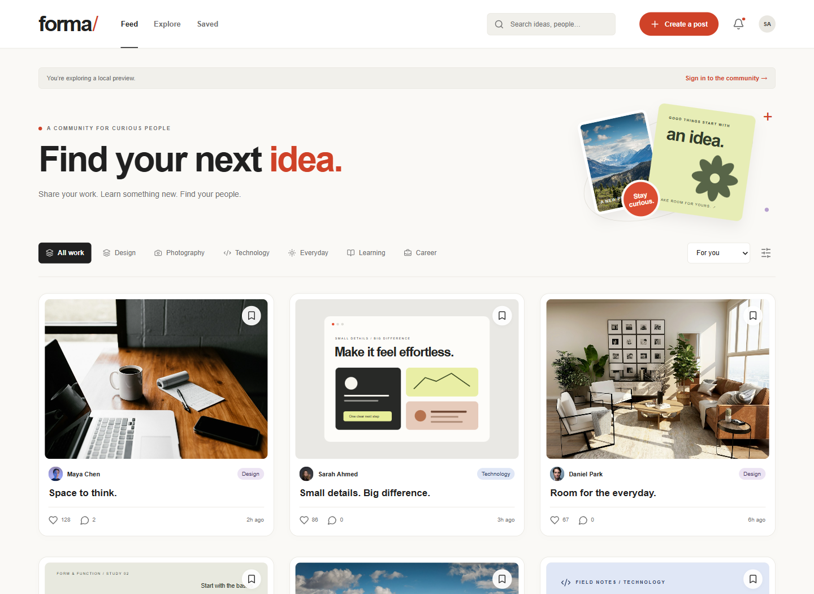
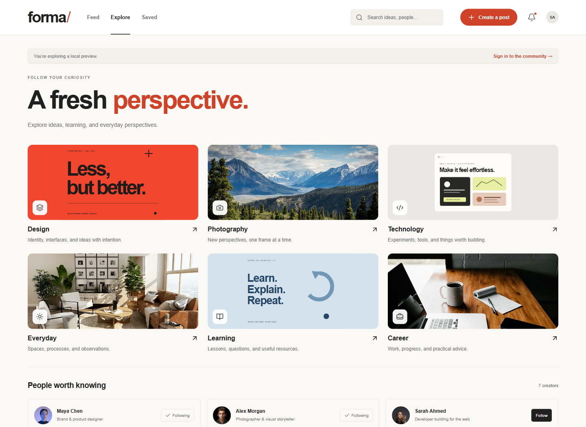
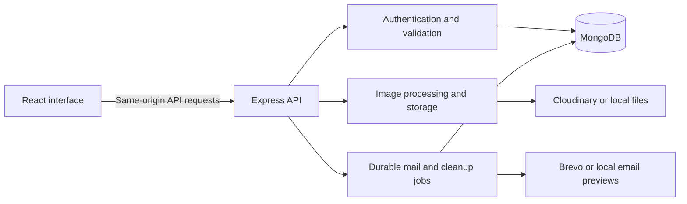

<div align="center">

# Forma — Full-Stack Social Media Platform

### Find your next idea.

A visual community for sharing work, discovering useful ideas, and connecting with people.

Built with **React, Node.js, Express, and MongoDB**, with cloud photo storage and transactional email.

[**Open Forma**](https://forma-social.vercel.app) · [**Explore the demo**](https://forma-social.vercel.app/demo) · [**Setup guide**](#run-locally) · [**Architecture**](#architecture)


</div>



*Interface previews use fictional demo profiles and sample content. They do not show private member data.*

[Features](#features) · [Technology](#technology-stack) · [Local setup](#run-locally) · [Feed ranking](#how-the-feed-works) · [Testing](#testing-and-verification) · [Deployment](#deployment) · [Documentation](#documentation)

## What is Forma?

Forma is a full-stack social networking application built on the MERN stack. It brings photo and text posts, topic discovery, member profiles, and private saved collections into one responsive workspace.

The project follows the complete path from a React interaction to an authenticated Express API request and persistent MongoDB data. It also includes the supporting workflows a shared application needs: email verification, password recovery, media processing, moderation, session management, and account deletion.

**Built by [Sheheryar Ahmad](https://github.com/Sheryar-Ahmad).** The live application is hosted on [Vercel](https://forma-social.vercel.app); the browser-only `/demo` lets visitors explore sample content without creating an account.

## Features

| Area | What you can do |
| --- | --- |
| Accounts and profiles | Register, verify your email, sign in, personalize your profile, and discover other members |
| Photo and text posts | Share work and ideas, add photo descriptions, edit your posts, and delete your own content |
| Community interactions | Like posts, write replies, follow creators, and review activity from other members |
| Discovery | Browse six topics, search posts and people, choose interests, and switch between For you, Following, Latest, and Popular |
| Private saves | Bookmark posts and organize them into named collections with filtering, renaming, and removal |
| Account security | Recover a password, change it with current-password verification, view sessions, and revoke access |
| Community controls | Block members, submit private reports, and review reports through verified moderator accounts |
| Data ownership | Export your account data and contributions, or close your account with password confirmation |
| Responsive interface | Use phone navigation, light/dark appearance, semantic HTML, native dialogs, and visible keyboard focus |

### Explore ideas visually



The interface keeps discovery, posting, and saving close to the content. System fonts, original SVG graphics, and locally stored sample photography keep the visual design consistent without external font requests.

### Details behind the interface

- **Safer editing:** revision checks reject stale changes instead of silently replacing a newer edit.
- **Processed uploads:** images under 2 MB are validated, bounded in dimensions, converted to WebP, and stripped of metadata. Animated GIFs become still images.
- **Private collections:** saves, preferences, email addresses, and notifications are private to their owner.
- **Resumable cleanup:** closing an account hides its content immediately and queues retryable content and photo removal.
- **Reliable email jobs:** verification and recovery messages use queued delivery, leases, and retries.
- **Clear pagination:** server-side filters and cursor pagination load additional posts through an explicit **Load more** control.

## Technology stack

| Layer | Technologies and purpose |
| --- | --- |
| Frontend | React, Vite, semantic HTML, CSS, and Lucide icons |
| Backend | Node.js, Express, Zod validation, and security middleware |
| Database | MongoDB and Mongoose models, indexes, and session records |
| Images | Sharp for processing; local storage for development or Cloudinary for cloud delivery |
| Email | Local message previews, Brevo over HTTPS, or SMTP on compatible hosts |
| Hosting | Vercel frontend and Node.js API function, with protected daily maintenance |
| Verification | Node.js test runner, Supertest, Playwright, and GitHub Actions |

## Architecture



React handles screens and interaction state. Express validates input, checks sessions and ownership, and reads or writes MongoDB records. The shared application keeps private account data on the server; the separate demo uses browser storage for its sample workspace.

On Vercel, `api/index.js` serves the API under the same domain as the frontend. Warm instances reuse a database connection. Successful requests schedule bounded background work with `waitUntil`, and an authenticated daily maintenance endpoint catches up on queued work.

### Code map

| Path | Responsibility |
| --- | --- |
| `client/App.jsx` | Routes, screens, and dialogs |
| `client/components/` | Focused presentation and form components |
| `client/lib/useCommunity.js` | Sessions, API state, mutations, pagination, and request ordering |
| `client/lib/state.js` | Demo reducer, validation, migrations, and feed ordering |
| `server/app.js` | Express middleware, route assembly, media, and errors |
| `server/routes/` | Posts, profiles, follows, bookmarks, collections, and activity |
| `server/models.js` | MongoDB models and indexes |
| `server/security.js` | Password hashing, opaque sessions, and origin checks |
| `server/media.js` | Image validation, conversion, storage, and cleanup |
| `server/serverless.js` | Vercel request lifecycle and bounded maintenance jobs |
| `api/index.js` | Vercel API entry point |
| `scripts/dev.js` | Local database, API, and Vite launcher |
| `tests/` | State, API, provider, serverless, and browser checks |

Start with the [plain-language code guide](docs/CODE_GUIDE.md) for an explanation of how the pieces work together.

## Run locally

### 1. Install the project

Use **Node.js 20.19+**, or a supported LTS release satisfying Vite's requirements, and npm.

```powershell
git clone https://github.com/Sheryar-Ahmad/CodeAlpha_Social_Media_Platform.git
cd CodeAlpha_Social_Media_Platform
npm ci
npm run dev
```

Open **http://127.0.0.1:5175**. The API runs on port **3002**.

With no custom environment configuration, the launcher finds an installed MongoDB binary or downloads one on first use. It starts MongoDB on loopback port **27018** and preserves data locally. The first download requires network access; cloud accounts are not needed for this default setup.

| Local path | Contents |
| --- | --- |
| `.data/mongodb` | Development accounts, posts, and other database records |
| `.data/uploads` | Uploaded development photos |
| `.data/mail` | Private email previews containing verification and recovery links |

These paths are ignored by Git. Keep them if you want to retain development data, and do not share email previews containing working account links.

### 2. Create and verify an account

Choose **Create account**, enter your details, then open the newest message addressed to your test account in `.data/mail`. Follow its verification link before posting or interacting. Local email previews do not send real messages.

For a quick visual walkthrough, visit **http://127.0.0.1:5175/demo** instead. Demo content stays in that browser and is not imported into a registered account.

### 3. Optional configuration

To connect your own MongoDB instance, copy `.env.example` to `.env` **if you do not already have an `.env` file**, set `MONGODB_URI`, and restart development. An existing `.env` overrides the default local setup and may connect to a cloud database.

Keep credentials in private environment settings. `APP_ORIGIN` must match the development address exactly, including host and port; avoid switching between `127.0.0.1` and `localhost`.

To grant moderator access to a verified local account while development is running:

```powershell
npm run moderator -- grant your_username
```

Client edits reload automatically. Restart after server changes, and use **Ctrl+C** to stop development. If a port is occupied, close the earlier Forma process before restarting.

## How the feed works

Forma uses a small, understandable ranking system based on activity inside the application:

| Signal | Contribution to For you ordering |
| --- | --- |
| Selected topics | +4 |
| Followed creators | +2 |
| Topics you like or save | Up to +1 |
| Freshness | Up to +1 across seven days |
| Popularity | A capped contribution of up to +0.2 |

Your own posts appear first. The browser applies an author-diversity adjustment to loaded results. **Latest** and **Following** use chronological order; **Popular** uses reactions.

The server returns up to 24 posts at a time, with a maximum of 48 per request. This is a transparent recommendation approach for the current application scope; it does not require an external recommendation service or cross-site tracking.

## Security and privacy

- Passwords use salted **scrypt** hashes.
- Session cookies are **HttpOnly**, **SameSite=Lax**, and **Secure** in production; MongoDB stores session token hashes.
- Writes validate the configured origin, request input, and applicable ownership or moderator permissions.
- Verification and password recovery links expire and are single-use. Password resets revoke existing sessions.
- Members can block accounts, report content, end sessions, export their data, and request account closure.
- Profiles and community contributions are visible to authenticated members. Media URLs are accessible to anyone who has the URL.
- Vercel uses MongoDB-backed rate limits so counters can be shared across function instances.

Implementation details and retention rules are documented in [backend decisions](docs/BACKEND.md) and [community rules](docs/COMMUNITY.md). Automated checks are evidence for the tested behavior, not a security certification or a complete accessibility audit.

## Testing and verification

```powershell
npm test
npm run test:browser
npm run test:live
npm run test:release
npm run build
```

| Check | Coverage |
| --- | --- |
| State and API tests | Validation, authentication, permissions, account workflows, providers, and serverless behavior |
| Preview browser suite | Demo interaction and responsive interface behavior |
| Shared-account browser suite | Interactions between isolated test accounts |
| Release browser suite | Built application behavior |
| Production build | Vite output for deployment |

Tests use isolated temporary databases and browser contexts. Browser suites use installed Microsoft Edge by default; configure `BROWSER_CHANNEL=chrome` or `BROWSER_EXECUTABLE` for another Chromium executable. Generated test screenshots stay in ignored `test-results/`.

GitHub Actions runs the automated tests, production build, and all three browser suites on pushes and pull requests. Check the [Actions history](https://github.com/Sheryar-Ahmad/CodeAlpha_Social_Media_Platform/actions) for individual run results, and [verification notes](docs/VERIFICATION.md) for scope and procedures.

For a manual check, create two verified accounts in separate browser sessions. Publish, reply, like, follow, and save from different accounts; check activity and collection privacy. Test conflicting edits in two tabs, then restart development and confirm that saved data and unexpired sessions persist.

## Deployment

**Live application:** [forma-social.vercel.app](https://forma-social.vercel.app)

Forma is configured for Vercel with MongoDB Atlas, Cloudinary, and Brevo. Follow the [deployment guide](docs/DEPLOYMENT.md) for environment variables, service setup, provider network access, maintenance authentication, and hosted acceptance checks.

```powershell
npm run prepare:vercel
```

This helper creates an **ignored private environment import file** from local settings. It does not deploy the application or send email. Never commit the generated file or expose database and provider credentials through browser-visible environment variables.

The application has been deployed, and its hosted health endpoint and unauthenticated access controls were checked during setup. Atlas connectivity, Cloudinary upload/delivery/deletion, and one Brevo inbox delivery were also verified. Complete registration, verification, recovery, and posting checks on the hosted application after configuration changes; service setup checks do not prove every production workflow.

For a persistent Node.js host, run `npm run build`, configure the documented production environment, and start with `npm start`. Local file storage and SMTP remain available on compatible hosts. `npm run preview` serves only the static client, not the shared application server.

## Current scope and limits

- Direct messages and real-time delivery are future features.
- Current account limits include 1,000 follows, 1,000 bookmarks, 20 collections, and the latest 100 notifications. Posts support 100 replies and 10,000 reactions.
- Larger communities will require further data-model and infrastructure work; existing limits keep this release bounded.
- The browser demo supports 200 posts and has separate storage warnings. Clearing browser data resets the demo, not server accounts.
- Provider quotas, database backups, monitoring, restore procedures, and hosted acceptance checks remain operational responsibilities.

The [roadmap](docs/PLAN.md) records implementation scope and follow-up work.

## Documentation

| Guide | What it explains |
| --- | --- |
| [Code guide](docs/CODE_GUIDE.md) | A beginner-friendly walkthrough of the codebase |
| [Backend decisions](docs/BACKEND.md) | API, persistence, authentication, and job behavior |
| [Deployment](docs/DEPLOYMENT.md) | Hosting, environment settings, and service configuration |
| [Verification](docs/VERIFICATION.md) | Automated checks and manual acceptance steps |
| [Community rules](docs/COMMUNITY.md) | Moderation, account closure, and retention |
| [Design decisions](docs/REDESIGN.md) | Interface direction and visual choices |
| [Roadmap](docs/PLAN.md) | Project scope and planned improvements |

## Design and asset credits

The interface uses system fonts and Lucide icons. SVG studies are original code-native graphics. Sample photographs and stock portraits are stored locally; member photos use Cloudinary's CDN when cloud storage is enabled.

Sample photography: [desk](https://images.unsplash.com/photo-1499750310107-5fef28a66643), [mountains](https://images.unsplash.com/photo-1464822759023-fed622ff2c3b), [interior](https://images.unsplash.com/photo-1600210492486-724fe5c67fb0), and [shelves](https://images.unsplash.com/photo-1494438639946-1ebd1d20bf85).

Stock portraits: [portrait 1](https://images.unsplash.com/photo-1534528741775-53994a69daeb), [portrait 2](https://images.unsplash.com/photo-1506794778202-cad84cf45f1d), [portrait 3](https://images.unsplash.com/photo-1524504388940-b1c1722653e1), [portrait 4](https://images.unsplash.com/photo-1500648767791-00dcc994a43e), and [portrait 5](https://images.unsplash.com/photo-1524250502761-1ac6f2e30d43).

Design references: [Behance discovery](https://help.behance.net/hc/en-us/articles/204484044-Guide-Discover-Creative-Work-on-Behance) and [Are.na's idea-saving purpose](https://www.are.na/about).

## Author and license

**[Sheheryar Ahmad](https://github.com/Sheryar-Ahmad)**<br>
Software Engineering · COMSATS University Islamabad

[Live application](https://forma-social.vercel.app) · [Source code](https://github.com/Sheryar-Ahmad/CodeAlpha_Social_Media_Platform)

Copyright © 2026 Sheheryar Ahmad. Licensed under the [MIT License](LICENSE).
